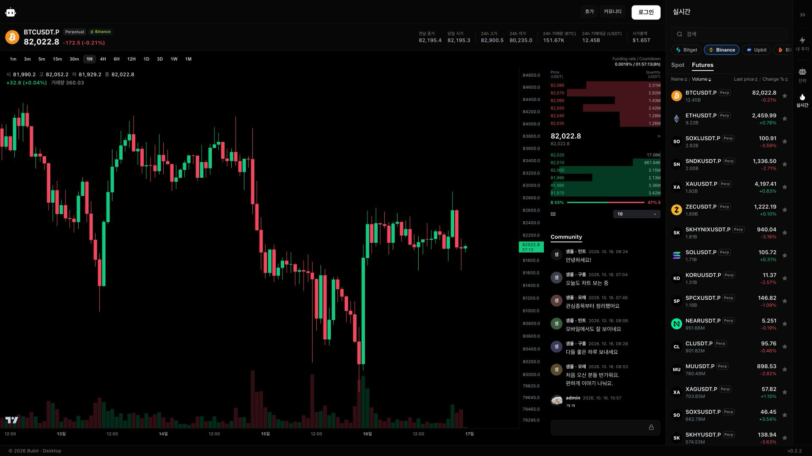
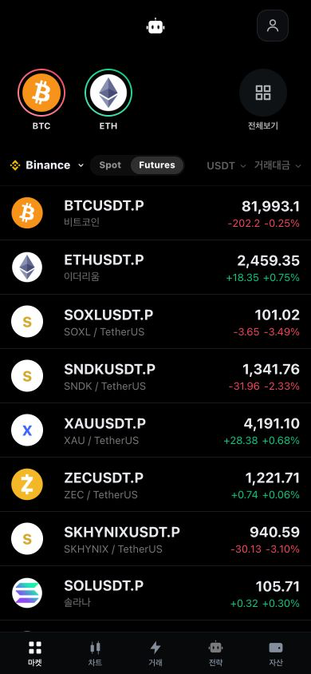
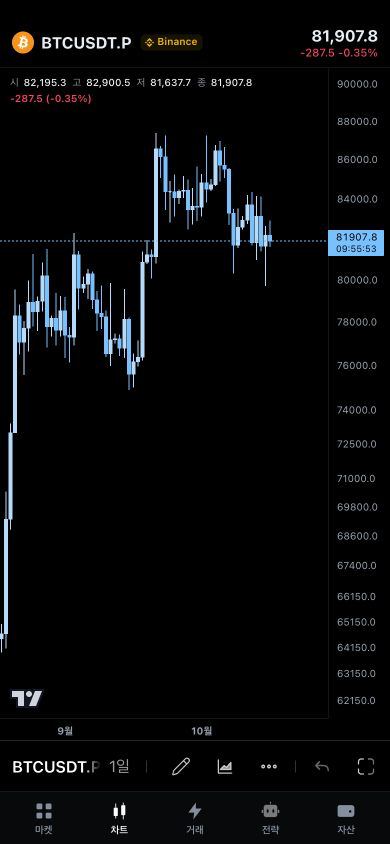

<p align="center">
  
</p>

<h1 align="center">Bubit</h1>

<p align="center">
  <strong>시세를 보고, 차트를 분석하고, 가상 자산으로 거래를 연습하는 공간.</strong><br />
  여러 거래소의 실시간 데이터를 연결한 PC·Mobile 암호화폐 분석 앱
</p>

<p align="center">
  <a href="https://bubit.ddnsfree.com/web/"><strong>PC 서비스 열기</strong></a> ·
  <a href="https://bubit.ddnsfree.com/mobile/"><strong>Mobile 서비스 열기</strong></a> ·
  <a href="docs/USER-GUIDE.md">사용 가이드</a> ·
  <a href="CHANGELOG.md">변경 이력</a>
</p>

<p align="center">
  <strong>v0.2.2</strong> · React 19 · TypeScript · Spring Boot 3 · Java 21<br />
  <a href="https://github.com/Hdev-x/Bubit/actions/workflows/ci.yml"></a>
</p>

> 이 저장소는 **포트폴리오용 공개 소스 snapshot**입니다. 개발·버전 관리·운영 배포는 별도의 비공개 저장소에서 진행하고, 검토한 앱 소스·테스트·문서만 이곳에 반영합니다. 공개 저장소의 변경이나 CI 실행은 서비스 배포로 이어지지 않습니다.

## 한 화면에서 이어지는 작업

거래소와 종목을 선택해 시세·호가·차트를 함께 살펴보고, 분석 도구와 드로잉으로 판단을 정리합니다. 로그인하면 모의계좌에서 주문을 연습하거나 전체 커뮤니티에 참여할 수 있습니다. PC는 여러 패널을 함께 보는 작업 공간으로, Mobile은 탭과 시트를 중심으로 구성했습니다.

### PC · 차트와 실시간 마켓

<p align="center">
  
</p>

### Mobile · 시장에서 차트까지

<table>
  <tr>
    <th align="center">시장</th>
    <th align="center">차트 분석</th>
  </tr>
  <tr>
    <td align="center"></td>
    <td align="center"></td>
  </tr>
</table>

미리보기는 2026-10-16 v0.2.2 서비스의 비로그인 화면입니다. PC는 1920×1080, Mobile은 390×844 브라우저 화면으로 촬영했습니다. 커뮤니티에는 샘플 메시지가 포함돼 있으며, 이미지 속 가격은 촬영 시점의 값입니다.

## 주요 기능

| 영역 | 구현한 기능 |
| --- | --- |
| 실시간 마켓 | Binance·Bitget·Upbit·Bithumb 시세, 현물/선물 전환, 검색·정렬·관심종목. 시장별 가격 정밀도를 적용하고 화면에 보이는 종목을 실시간 구독 |
| 차트 분석 | 시간봉 전환, 보조 지표, SMC·하모닉·파동 분석, 드로잉과 오브젝트 관리. 고급 분석은 로그인 후 이용 |
| 내 투자 | 실제 계좌 조회와 모의계좌를 캡슐 버튼으로 전환. 모의투자 기본 활성·주문창 기본 닫힘, 메뉴 이동 후 마지막 선택 유지 |
| 모의투자 | 가상 잔고 10,000 USDT, Bitget USDT 선물 시장가·지정가, 롱·숏, 레버리지, 주문 취소·포지션 청산. 다른 거래소 차트를 보면서도 Bitget 시세 기준으로 주문 |
| 전체 커뮤니티 | 종목과 관계없이 같은 채팅에 참여. 최신 메시지 하단 표시, 닉네임·날짜·시간, 댓글·좋아요·사진 첨부, 본인 글 수정·삭제 |
| 개인 설정 | 프로필 사진·닉네임, Bitget API 연결, 모의계좌 초기화를 공통 설정 창에서 관리 |

시장과 차트는 로그인 없이 열람할 수 있습니다. 회원가입은 PC에서 진행하며, Mobile의 거래·전략·자산 탭에는 로그인이 필요합니다. 거래소별 상품 지원과 기능별 이용 조건은 [사용 가이드](docs/USER-GUIDE.md)에 정리했습니다.

## 구현에서 집중한 문제

### 1. 실시간 가격을 과거 응답이 덮지 않도록

REST로 받은 초기 데이터 위에 WebSocket 변경을 이어 붙입니다. 이때 늦게 도착한 REST 응답이 이미 갱신된 현재 봉을 되돌리지 않도록, 요청 중 바뀐 OHLC·거래량은 보존합니다. 거래소·상품·종목·시간봉과 요청 세대를 함께 확인해 빠른 A→B→A 전환에서도 이전 응답과 종료된 구독을 구분합니다.

관련 코드: [캔들 병합과 갱신](apps/web/src/chart/hooks/useCoinCandles.ts) · [시장 식별자](apps/web/src/chart/hooks/marketKey.ts) · [현재가 상태](apps/web/src/hooks/market/useLivePrice.ts)

### 2. 종목 목록과 실시간 구독의 비용을 분리

시장별 목록 요청과 캐시를 공유해 거래소 전환과 관심종목 화면에서 중복 조회를 줄였습니다. 목록은 40개 단위로 표시 범위를 늘리되, 실제 렌더링과 시세 구독은 화면 주변 범위로 제한합니다. **40개씩 서버에서 페이지를 가져오는 방식은 아닙니다.** 서버에서도 활성 구독을 추적하고, 중계할 가격은 최신 값으로 모아 불필요한 송출을 줄입니다.

관련 코드: [공유 목록 저장소](apps/web/src/api/server/marketTickerLists.ts) · [목록 표시·구독 범위](apps/web/src/app/desktop/panels/MarketPanel.tsx) · [서버 구독 관리](apps/api/src/main/java/com/bubit/market/coin/TickerSubscriptions.java)

### 3. 화면 구조를 나눠도 동작과 스타일을 유지

PC·Mobile의 화면 구성은 분리하고, 차트·시세 훅·개인 설정·커뮤니티·모의투자는 공용 영역에서 재사용합니다. CSS를 컴포넌트 가까이 옮길 때는 선언 순서와 빌드 결과까지 검사해 우선순위가 달라지는 회귀를 감지합니다. 실제 계좌 조회와 가상 주문은 분리하고, 모의계좌 변경은 서버에서 회원별 계좌 행 잠금으로 직렬화합니다.

관련 문서: [구조와 데이터 흐름](docs/ARCHITECTURE.md) · [문제별 원인·해결·검증](docs/TROUBLESHOOTING.md)

## 검증과 운영 관찰

| 검증 계층 | 확인하는 내용 |
| --- | --- |
| Web · Vitest | 지연·역순 응답, 종목 전환, 구독 정리, 주요 화면 상태 |
| API · JUnit/H2 | 인증·소유권·mapper 계약과 서비스 동작. 테스트용 DB·mock 사용 |
| 빌드 · CI | ESLint, PC·Mobile 빌드, CSS 순서·중복 검사, API 테스트와 실행형 JAR 생성 |

2026-10-16에는 실행형 JAR 서비스에서 **기준 2분 → 지속 부하 15분 → 회복 3분**을 관찰했습니다.

| 항목 | 관찰 결과 |
| --- | ---: |
| 공개 시세 연결 | 최대 8개, 연결당 45 topic |
| 수신 메시지 | 1,100,572건 |
| HTTP 조회 | 399회 모두 예상 상태 코드 |
| 부하 구간 CPU | 평균 9.06% · 최대 11.64% |
| WebSocket 오류·예상 외 종료·서비스 재시작 | 0건 |

CPU는 2 vCPU 전체를 100%로 둔 값입니다. 부하 종료 후 CPU와 열린 파일 수가 기준 수준으로 회복됐으며, 중간 재접속에서도 시세를 다시 수신했습니다. 이 측정은 제한된 공개 데이터 조회 부하의 관찰이며 **24시간 안정성·대규모 동시 접속·브라우저 렌더 지연·실제 주문 처리량을 입증하지 않습니다.** WAR 대비 성능 개선을 비교한 시험도 아닙니다.

## 코드 둘러보기

| 경로 | 역할 |
| --- | --- |
| [`apps/web/src/app`](apps/web/src/app) | PC·Mobile 진입점, 패널과 공용 제품 화면 |
| [`apps/web/src/chart`](apps/web/src/chart) | 캔들·지표 표시, 분석 설정과 드로잉 |
| [`apps/web/src/hooks`](apps/web/src/hooks) | 시세·계좌·화면 상태와 생명주기 |
| [`apps/web/src/api`](apps/web/src/api) | 앱 API·거래소 연결·인증 클라이언트 |
| [`apps/api/src/main/java/com/bubit`](apps/api/src/main/java/com/bubit) | Spring API, WebSocket 중계, 인증·프로필·커뮤니티·모의투자 |
| [`shared`](shared) | React·DOM에 의존하지 않는 분석 계산과 schema |

**Frontend** — React 19 · TypeScript · Vite · Lightweight Charts · Vitest<br />
**Backend** — Java 21 · Spring Boot 3 · Spring Security · STOMP/WebSocket · MyBatis · PostgreSQL<br />
**실행 형태** — PC·Mobile Web + 내장 서버를 포함한 Spring Boot JAR

## 로컬에서 실행하기

Node.js 22, Java 21, PostgreSQL, Python 3가 필요합니다.

```bash
git clone https://github.com/Hdev-x/Bubit.git
cd Bubit
```

1. [로컬 실행 가이드](docs/SETUP.md)에 따라 새 DB에 schema와 후속 SQL을 적용하고 API 설정을 준비합니다.
2. `apps/api`에서 `./gradlew bootRun --args='--spring.profiles.active=paper'`로 API를 실행합니다.
3. `apps/web`에서 `npm ci` 후 별도 터미널로 `npm run dev:desktop`과 `npm run dev`를 실행합니다.

| 화면 | 로컬 주소 |
| --- | --- |
| PC | [localhost:5174/web/](http://localhost:5174/web/) |
| Mobile | [localhost:5173/mobile/](http://localhost:5173/mobile/) |

설정 예제에는 실제 credential이 없으며, API 테스트는 PostgreSQL 연결 없이 H2로 실행합니다. `paper` profile은 가상계좌 기능만 활성화합니다. 공개본에는 자동매매 worker·운영 설정·사용자 데이터·배포 자동화가 포함되지 않습니다.

## 이용 범위와 문서

Bitget 연결은 자산·포지션·미체결 주문 **조회용**입니다. 실제 거래소 주문·자동매매는 제공하지 않습니다. 모의투자는 수수료·펀딩·강제청산·TP/SL을 반영하지 않으며, 거래소 응답과 네트워크 상태에 따라 데이터 갱신이 지연될 수 있습니다.

- [사용 가이드](docs/USER-GUIDE.md) — 지원 기능과 현재 제한
- [변경 이력](CHANGELOG.md) · [버전 관리](docs/RELEASING.md) — 사용자 변경과 공개 snapshot 갱신
- [데이터 안내](docs/DATA.md) — DB·브라우저 저장 정보와 삭제 범위
- [지원 안내](SUPPORT.md) · [보안 신고](SECURITY.md) — 일반 피드백과 취약점 신고 경로
- [외부 라이브러리와 출처](docs/THIRD_PARTY.md)

표시 버전은 앱 버전이며 GitHub Release 발행 여부와는 구분합니다. Bubit 자체의 별도 오픈소스 라이선스는 아직 지정하지 않았습니다.
