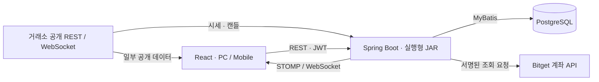

# 구조와 데이터 흐름

## 구성

운영 빌드·배포는 비공개 개발 저장소에서 관리합니다. 이 공개본은 앱 구조와 로컬 실행을 살펴보기 위한 선별 소스입니다.

## 폴더 경계

- `apps/web/src/app/{desktop,mobile}`: 화면 배치·탭·패널과 앱 진입점
- `apps/web/src/app/shared/{account,community,paper}`: PC·Mobile 공용 제품 화면
- `apps/web/src/chart`: 차트 표시, 분석, 설정과 드로잉
- `apps/web/src/hooks/{market,account,ui}`: 시세·계좌·화면 상태
- `apps/web/src/api/{client,server,exchange}`: HTTP/인증과 거래소 연결
- `apps/web/src/shared`: 앱 공용 UI·타입·유틸리티
- 루트 `shared`: React나 DOM에 의존하지 않는 분석 계산
- `apps/api/src/main/java/com/bubit`: `member` 인증·프로필·API 키 관리, `community` 게시글·댓글, `market/coin` 시세 중계, `trade` 계좌 조회·수동 모의투자, `common` 보안·이미지 처리·공통 설정

화면에서 차트·훅을 호출하고, 훅이 API와 공용 계산을 사용합니다. 루트 `shared`는 앱 화면을 참조하지 않습니다.
공개본은 서비스의 선별 소스를 포함하며 비활성 봇 서버와 부팅 시 자동 DDL 실행 코드는 포함하지 않습니다.

## 시세가 화면에 도착하는 과정

1. 사용자가 거래소·현물/선물·종목·시간봉을 선택합니다.
2. REST 요청으로 캔들과 초기 값을 받고 WebSocket으로 실시간 변경을 이어받습니다.
3. 데이터에는 선택 조건과 요청 세대를 결합한 식별자를 붙입니다. 이전 요청의 응답은 새 선택에 적용하지 않습니다.
4. 새 차트 데이터가 준비되면 표시 대상과 캔들·가격·지표를 함께 교체합니다. 같은 차트 안의 전환은 기존 완성 화면을 유지하며, 마켓에서 다른 종목으로 진입할 때는 선택한 종목의 빈 틀을 먼저 보여줍니다.

REST는 스냅샷 보정, WebSocket은 실시간 갱신을 담당합니다. refresh 도중 WebSocket이 바꾼 현재 봉의 필드는 늦은 REST가 덮지 못하게 보호합니다.

## 인증과 계좌 정보

Spring Security가 JWT를 검증하고 회원 비밀번호는 BCrypt로 해시합니다. 저장되는 거래소 자격증명은 서버 암호화 키로 암호화합니다.
WebSocket 인증은 CONNECT 프레임의 Authorization으로 전달합니다. 토큰을 URL query에 넣지 않습니다. 비로그인은 허용된 공개 시세·커뮤니티 topic만 구독하며 게시글·계정 변경은 로그인과 서버 소유권 검사를 거칩니다.
모의투자는 `paper` profile로 활성화하며 서버가 Bitget 공개 선물 시세로 체결합니다. 회원별 계좌 행 잠금으로 주문·취소·청산·초기화를 직렬화합니다.
서버 키는 실행 환경에서 주입하며 `VITE_*` 변수에 넣지 않습니다. 클라이언트에 포함되는 값은 비밀이 될 수 없습니다.

## 검증 경계

Web의 Vitest 테스트는 지연 응답·종목 전환·구독 종료와 DOM 상태를 검증합니다.
API 테스트는 H2와 mock을 사용하며 실제 계좌·주문·운영 DB를 호출하지 않습니다.
CSS 검사는 과거 규칙 순서의 고정 fingerprint와 현재 소스·빌드 결과를 비교하므로 개발 저장소의 과거 커밋이 필요하지 않습니다.
